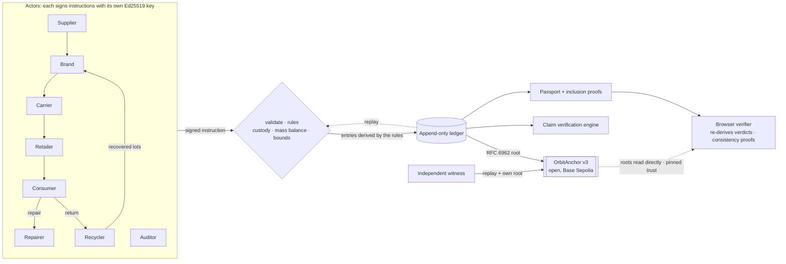

# Orbit: verifiable circular supply chains

> Green claims, checked against the supply chain. Orbit gives every product a **digital product passport** backed by a ledger of **instructions signed by each party**, which anyone can **replay** to re-derive every entry. The ledger is **anchored on a public blockchain** with RFC 6962 Merkle roots, and Orbit **checks every sustainability claim against that record** to catch greenwashing automatically.

Built for the **IEEE ClimateChain Global Hackathon**, track **Sustainable Supply Chains**: *increase transparency and accountability in supply chains, where ethical sourcing and sustainability claims are hard to verify.*

⛓️ **Live contract:** [`OrbitAnchor` v3 on Base Sepolia · 0x8a9b…9151](https://sepolia.basescan.org/address/0x8a9bd10b411a5509916dbe812fd803611c2f9151). Source verified: exact match on [Sourcify](https://repo.sourcify.dev/84532/0x8A9BD10b411A5509916dbe812fd803611C2F9151), readable on [Blockscout](https://base-sepolia.blockscout.com/address/0x8A9BD10b411A5509916dbe812fd803611C2F9151?tab=contract). The contract is open: anyone can anchor. Its history shows checkpoints from Orbit's operator wallet and from a witness wallet (in this demo the witness is a second wallet run by our team, to show the role).

📄 [Problem statement](docs/PROBLEM_STATEMENT.md) · 🌍 [Climate impact assessment & projections](docs/IMPACT.md) · 🔐 [Security & data integrity assessment](docs/SECURITY.md) · 📝 [Devpost write-up](docs/DEVPOST.md)

| Track idea | What Orbit does |
| --- | --- |
| Product lifecycle tracking | Every handover (sourcing, manufacture, shipping, sale, repair, return, recycling) is an **instruction signed by the party doing it** (Ed25519). The ledger is hash-chained and anchored on-chain, and **every entry can be re-derived** from those instructions. |
| Digital product passports | A public passport page per product (QR code + GS1 Digital Link) and a JSON-LD export in the shape of a UNTP / W3C Verifiable Credential, with **RFC 6962 inclusion proofs**. The browser verifies it against the chain and **re-derives every claim verdict itself**. |
| Recycling traceability | Recyclers **sign the mass they recovered** (bounded by what went in), creating new recycled lots linked to the source product. Recycled content is **proven by mass balance**, not declared. |
| Circular economy incentives | **Non-transferable** credits for returning (a return reward funded by the brand's EPR fee in a real scheme), repairing and recycling. They're minted only as a rule-derived consequence of a signed event, so the operator can't mint from nothing ([why not a token](#incentives-why-credits-are-not-a-tradable-token)). |
| *(Accountability layer)* | A **claim verification engine** grades every product A–E. Claims are checked against **counter-party data**: lots signed by suppliers, receipts signed by recipients, audits signed by auditors. Self-reported inputs are disclosed, and vague wording is linted against EU Directive 2024/825. |

## The demo story

| Passport | What it shows |
| --- | --- |
| 👕 **Orbit Tee** · grade **A** | Honest product. Its 40% recycled claim matches lot lineage, every declared transport mode fits the recipient's signed arrival time, and the labour claim is approved by an auditor. The carbon claim carries a caveat because 54% of it is self-reported factory data. |
| 🧥 **EcoCloud Hoodie** · grade **E** | Greenwashing, caught four ways. It claims "70% recycled, 100% eco-friendly", but the lots prove **6.7%**. Lumen **declared sea freight**, but GreenLoop's **signed receipt 24 h later** proves 2,892 km could only have gone by air, which makes "carbon neutral 1.2 kg" really **6.0 kg**. And the auditor rejected the labour claim. |
| 🔋 **Strata E-bike Battery** | Full life: shipped → sold → **repaired** (owner earns credits) → **returned** (return reward) → **recycled**. The recycler signs the recovered masses, creating 3 recovered lots. |
| ♻️ **Strata Loop Edition** | **Closed loop.** Built from those lots: **93% recycled content** and about 65% lower footprint, linked back to its ancestor passport. |

**Live demo path (3 minutes)**
1. **Overview → "See a greenwashed product get caught"**: the hoodie's contradicted claims, including the misdeclared sea freight.
2. **Ledger → Tamper simulator.** Three attacks, three layers of defence:
   - *Database intruder* inflates a credit, and the hash breaks.
   - *Malicious operator* shrinks a freight leg and re-signs. Signatures pass, but **replay** recomputes 2,892 km.
   - *Malicious operator* **erases the failed audit and regenerates all later history through the real rules**. Every local check passes; only the **on-chain roots** disagree.

   Simulations stay in memory and auto-restore after 90 s.
3. **Verify**: your browser checks every key, signature and binding, re-derives each claim verdict, confirms the checkpoint came from Orbit's **pinned** operator on the **pinned** contract, proves inclusion (RFC 6962), and proves the history is **append-only** against every trusted checkpoint.
4. **Console**:
   - Click **"Create my key & join"** to become a consumer whose private key is generated in your browser and never leaves it.
   - As GreenLoop, sell yourself something. Then return it for the return reward.
   - As Re:Fibre, weigh and sign the recovered material.

## Quick start

```bash
npm install
npm run dev          # http://localhost:3000; demo mode on; checkpoints stay local-only without a chain
npm test             # 46 tests (node:test)
```

> **Judges:** a fresh clone generates its own random keys and a new ledger, so nothing in it is anchored on our contract. To see anchoring, follow the steps below (about 5 minutes with a faucet), or inspect the public history of [our contract](https://sepolia.basescan.org/address/0x8a9bd10b411a5509916dbe812fd803611c2f9151).

### Anchor on a public testnet (Base Sepolia by default)

```bash
npm run wallet            # creates Orbit's anchor wallet in .env.local and prints its address
# fund that address with a little Base Sepolia ETH from a faucet
npm run deploy:anchor     # deploys OrbitAnchor, writes ORBIT_ANCHOR_ADDRESS to .env.local
npm run dev               # anchored on boot and ~45 s after the last write
```

Add your deployment and operator address to `OFFICIAL_ANCHORS` in `src/lib/networks.ts`, so the browser verifier trusts them.

**Be an independent witness** (any auditor, recycler or NGO can do this, from its own wallet):

```bash
npm run wallet -- --witness                                    # a wallet Orbit doesn't control
ORBIT_URL=http://localhost:3000 npm run witness                # re-verify everything, then anchor what you saw
ORBIT_URL=http://localhost:3000 npm run witness -- --watch 120 # keep watching (downloads only new entries)
```

The witness downloads the ledger and **re-verifies it in full**: hashes, signatures, and replay of every instruction. It then compares the ledger with every root already published by Orbit or by named witnesses. If anything disagrees, it **refuses to anchor and raises an alert**. Roots from unidentified wallets are reported but can't block it. `npm run chain:local` starts a local node for `npm run test:chain`.

## How it works



- **The ledger is the only truth.** No mutable state is stored. Actors, lots, products, claims, audits, credits and checkpoints are rebuilt by **replaying** the signed instructions through the same rules as the live API (`replay.ts`). The same replay is a verifier: if anyone, the operator included, alters derived data (a distance, a credit amount, a recovered lot) or adds an entry with no instruction behind it, replay reports exactly what differs.
- **Writes** (`dispatch.ts`): signature against the registered key, ledger id, 5-minute freshness, nonce, no impersonation, and strict schema validation. Then the rules run (`actions.ts`), and one sequencer timestamp is bound to the signed time.
- **Merkle trees** follow **RFC 6962** (as in Certificate Transparency): domain-separated leaves and nodes, inclusion proofs bound to index and size, and **consistency proofs** that a later root only appends to an earlier one. `OrbitAnchor` verifies both natively in Solidity.
- **Trust is pinned, not discovered.** The contract is open, so anyone can anchor. Verifiers trust only Orbit's operator address and named witnesses, pinned in code (`networks.ts`). A forger's checkpoint or a griefer's junk root can't pass or break verification.
- **Counter-party cross-checks** (`domain.ts`): the recipient's signed arrival time tests the shipper's declared transport mode. Lot lineage tests recycled content. Auditors' signatures test labour claims.

See **[docs/SECURITY.md](docs/SECURITY.md)** for the full threat model: who can do what, how it is caught, what is tested, and what remains possible (the oracle problem).

## Why a blockchain (and why only roots)

A signed database proves who said what, but whoever runs it can rewrite history and re-sign it. The "erase" attack does exactly that and **passes every local check, replay included**. What the chain adds:

1. **Public, unrevisable timestamps.** A Merkle root in a Base block can't be changed by Orbit or anyone else.
2. **Append-only, provably.** With RFC 6962 consistency proofs, a later root must extend every earlier trusted root. A rewritten history can't be made consistent, whatever length it is re-anchored at.
3. **No gatekeeper.** Anchoring is open. Independent witnesses publish roots from their own wallets, so if Orbit rewrites, drops or withholds events, their roots contradict it. Orbit's wallet has no special rights in the contract.
4. **Verification without trust.** Passports carry inclusion proofs. The browser reads roots straight from the chain via a public RPC, checks them against pinned trust roots, and re-derives verdicts itself. Other contracts can call `verifyInclusion` and `verifyConsistency` on Orbit events too.

Only 32-byte roots go on-chain. Supplier identities, volumes and prices stay off-chain, and one transaction covers any number of events.

## Scalability

Measured with `node scripts/bench.ts 10000` on a Windows dev laptop (Node 24, native Ed25519). On-chain figures come from our Base Sepolia transactions.

| Operation | Cost | Grows with |
| --- | --- | --- |
| Signed write (verify instruction, validate, apply rules, sequence, append one log line) | ≈ 0.6 ms | constant (indexed) |
| Integrity check after a write (hashes, signatures and replay, incrementally) | ≈ 1.3 ms at 10,000 entries | O(new entries) |
| Full independent audit from scratch, replay included (what a witness does) | ≈ 0.7 ms per entry (7 s for 10,000) | O(n), one-off |
| Passport export with RFC 6962 proofs | ≈ 15 ms at 10,000 entries | O(events · log² n) |
| Inclusion proof size | 14 hashes, 448 bytes at 10,000 entries | O(log n) |
| On-chain anchor | ≈ 146k gas (measured), covering any number of events | constant |
| Anchor fee on Base Sepolia | ≈ 9 × 10⁻⁷ ETH at 0.006 gwei (measured) | constant |
| Anchor fee on Base mainnet (estimate) | at 0.005–0.05 gwei: 7 × 10⁻⁷ – 7 × 10⁻⁶ ETH, ≈ $0.002–$0.02 at $3,000/ETH | constant |

Hourly anchoring costs roughly **$20–$200 per year per ledger, whatever the event volume**. Storage is an append-only JSON Lines log: a write appends one line, and state is rebuilt by replay on start. Witnesses download incrementally (`/api/ledger?from=N`). Production would use Postgres with an append-only ledger table, with one ledger per brand or consortium (`ledgerId` already partitions checkpoints on-chain).

## Incentives: why credits are not a tradable token

Orbit's circular credits are deliberately **non-transferable and redeemable only for rewards**:

- **They reward behaviour, not speculation.** A tradable token invites farming, wash-trading and price swings, and a return reward that's worth a different amount next week stops working as an incentive.
- **Regulation.** A transferable token with market value can fall within the EU's MiCA crypto-asset rules. Closed-loop rewards redeemable within a limited network are treated differently. We don't want legal classification to drive the design of a recycling incentive.
- **They're still accountable.** Credits are minted only as a rule-derived consequence of a signed return, repair or recovery. Replay rejects any credit that the rules don't produce, and every mint sits inside the anchored roots.
- **There's an on-chain path if a scheme wants one.** `OrbitAnchor.verifyInclusion` proves events on-chain, so a token contract (non-transferable ERC-5192, or ERC-20 if a regulator approves) could mint **only** against an anchored `RETURNED` or `RECYCLED` event from Orbit's pinned operator.

## API

| Method | Path | Body |
| --- | --- | --- |
| `GET` | `/api/passport/:id` | n/a. Returns the JSON-LD passport with RFC 6962 inclusion proofs and an anchor reference. |
| `GET` | `/api/ledger[?from=N]` | n/a. Returns entries, `ledgerId`, registered keys and an integrity report (what witnesses consume). |
| `GET` | `/api/proof?m=&n=` | n/a. Returns an RFC 6962 consistency proof from size m to n (verifiers check it against on-chain roots). |
| `POST` | `/api/actions/{create-batch, manufacture, ship, receive, sell, repair, return, recycle, issue-claim, attest, redeem, register-actor}` | `{ request: {action, ledger, actorId, body, nonce, issuedAt}, signature }`, signed by the actor. Self-registration is open only to consumers. |
| `POST` | `/api/actions/anchor` | `{}`. Publishes the current root (no-op if unchanged, rate-limited). |
| `POST` | `/api/actions/{tamper, restore, reset}`, `GET /api/demo/keys` | Demo mode only. Tamper is memory-only and auto-restores after 90 s; reset is limited to once per 2 minutes. |

## Stack

Next.js 15 · React 19 · TypeScript · Tailwind CSS v4 · Ed25519 & SHA-256 via Node's native crypto on the server and audited `@noble/curves` / `@noble/hashes` in the browser (byte-identical, strict RFC 8032) · `viem` · Solidity 0.8.26 (`solc`, verified on Sourcify) · `motion`, `@number-flow/react`, `lucide-react`, `sonner` for the UI.

## Standards it borrows from

UNTP Digital Product Passport & W3C Verifiable Credentials (data shape) · GS1 EPCIS 2.0 & Digital Link (GTINs in the restricted-circulation range) · RFC 6962 / RFC 9162 Merkle trees · EU ESPR 2024/1781 · EU Battery Regulation 2023/1542 · EU Directive 2024/825 (greenwashing) · GLEC Framework (transport emissions).

## Project layout

```
src/lib/          core engine (framework-free, unit tested)
  crypto.ts       canonical JSON, pluggable Ed25519/SHA-256, RFC 6962 Merkle tree + proofs
  crypto-node.ts  native backend for servers, scripts and tests
  auth.ts         signed instructions + entry/instruction binding checks
  dispatch.ts     the single write path: validation, signatures, freshness, nonce, ledger id
  actions.ts      protocol rules (custody, roles, mass balance, recovery bounds, credits)
  replay.ts       deterministic replay: rebuilds all state, verifies every derived entry
  ledger.ts       append, incremental integrity verification, the ledger's Merkle tree
  domain.ts       indexed views: custody, mass balance, carbon, transport cross-checks
  verify.ts       claim verification engine + trust score
  passport-verify.ts  trustless passport verification (browser + tests)
  chain.ts        publish & check anchors (viem)   anchor-read.ts  browser-safe reads
  networks.ts     networks, ABI, pinned trust roots
  store.ts        append-only JSON Lines storage (state rebuilt by replay)
  seed.ts         reproducible demo world, every action actor-signed
contracts/        OrbitAnchor.sol (v3) + artifact + Solidity metadata
scripts/          compile, wallet, deploy, witness, fund, keystore, bench
tests/            core, storage, RFC 6962 and browser-verifier tests; on-chain integration test
docs/             problem statement, impact assessment, security assessment, Devpost text
```

## Limitations

- **Demo keys.** Demo mode serves role-play keys (on in development, opt-in in production). Guest consumers are non-custodial; in production all keys stay in actors' wallets.
- **Demo witness.** The witness in this demo is a second wallet run by our team, not an independent party.
- **Emission factors** are illustrative.
- **Oracle problem.** A recycler can inflate its yield up to the input mass, and a shipper can record SHIPPED early. Scale weights and carrier pickup signatures are the fix.

The full list is in [SECURITY.md §6](docs/SECURITY.md#6-residual-risks--limitations).

## Inspiration & prior art

We studied these open-source projects before designing Orbit. All code here is our own.
[eclipse-tractusx/digital-product-pass](https://github.com/eclipse-tractusx/digital-product-pass) · [openepcis/openepcis-dpp-ready](https://github.com/openepcis/openepcis-dpp-ready) · [artiso-ai/dppvalidator](https://github.com/artiso-ai/dppvalidator) · [faizack/Supply-Chain-Blockchain](https://github.com/faizack/Supply-Chain-Blockchain) · [geraldinabeutnagel/ChainTrace](https://github.com/geraldinabeutnagel/ChainTrace)

## License

MIT
