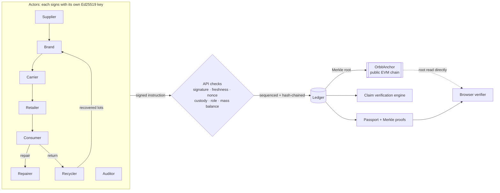

# Orbit: verifiable circular supply chains

> Green claims, checked against the supply chain. Orbit gives every product a **digital product passport** backed by **actor-signed, hash-chained records whose Merkle roots are anchored on a public blockchain**, then **checks every sustainability claim against that record** to catch greenwashing automatically.

Built for the **IEEE ClimateChain Global Hackathon**, track **Sustainable Supply Chains**: *increase transparency and accountability in supply chains, where ethical sourcing and sustainability claims are hard to verify.*

📄 [Problem statement](docs/PROBLEM_STATEMENT.md) · 🌍 [Climate impact assessment & projections](docs/IMPACT.md) · 🔐 [Security & data integrity assessment](docs/SECURITY.md) · 📝 [Devpost write-up](docs/DEVPOST.md)

| Track idea | What Orbit does |
| --- | --- |
| Product lifecycle tracking | Every handover (sourcing, manufacture, shipping, sale, repair, return, recycling) is an EPCIS-style event. It carries an **instruction signed in the actor's own browser or wallet (Ed25519)**, is **hash-chained**, and its Merkle root is **anchored on-chain** (`OrbitAnchor.sol`). |
| Digital product passports | A public passport page per product (QR code + GS1 Digital Link) and a **UNTP / W3C VC-style JSON-LD export with Merkle inclusion proofs**. The browser verifies it against the blockchain directly. |
| Recycling traceability | Recyclers turn returned products into **new recycled material lots linked to their source product**. Recycled content is **proven by mass balance**, not declared. |
| Circular economy incentives | The protocol mints **credits** only when a matching signed event exists: deposit refund on return, a bonus for repair-instead-of-replace, and recovery credits per kg. |
| *(Accountability layer)* | A **claim verification engine** grades every product A–E. Claims the data contradicts are flagged, **self-reported inputs are disclosed** (the oracle problem), and vague wording such as "eco-friendly" or "carbon neutral" is linted against EU Directive 2024/825. |

## The demo story

| Passport | What it shows |
| --- | --- |
| 👕 **Orbit Tee** · grade **A** | Honest product. Its 40% recycled claim matches batch lineage, and the labour claim is approved by an independent auditor. The carbon claim is verified but flagged because 54% of it rests on self-reported factory data. |
| 🧥 **EcoCloud Hoodie** · grade **E** | Greenwashing. It claims "70% recycled, 100% eco-friendly", but the ledger proves **6.7%**. "Carbon neutral 1.2 kg" is contradicted by **6.0 kg** (it was air-freighted), and the auditor rejected the labour claim. |
| 🔋 **Strata E-bike Battery** | Full life: shipped → sold → **repaired** (owner earns credits) → **returned** (deposit refunded) → **recycled** into 3 new recovered lots. |
| ♻️ **Strata Loop Edition** | **Closed loop.** Built from those recovered lots: **93% recycled content** and about 65% lower footprint, linked back to its ancestor passport. |

**Live demo path (3 minutes)**
1. **Overview → "See a greenwashed product get caught"**: shows the hoodie's contradicted claims.
2. **Ledger → Tamper simulator → "Hide the hoodie's air-freight leg"**: a malicious operator rewrites and **re-signs** all later history. Every local hash and signature still checks out, but the **on-chain anchor shows MISMATCH**, and the passport turns red.
3. **Verify**: your browser re-checks keys, signatures, signed-instruction bindings and Merkle proofs, then reads the root **straight from the chain**.
4. **Console**: act as Priya and return the tee (+20 credits); the request is signed in your browser. As Re:Fibre, recycle it. As Lumen, claim "90% recycled" on the hoodie and watch it get contradicted.

## Quick start

```bash
npm install
npm run dev          # http://localhost:3000 (works without a chain: checkpoints stay local-only)
npm test             # 22 unit tests (node:test)
```

### Anchor on a public testnet (Base Sepolia by default)

```bash
npm run wallet          # creates an anchor wallet in .env.local and prints its address
# fund that address with a little Base Sepolia ETH from a faucet
npm run deploy:anchor   # deploys OrbitAnchor, writes ORBIT_ANCHOR_ADDRESS to .env.local
npm run dev             # the ledger is anchored on boot and ~20 s after every write
```

Use `ORBIT_CHAIN=sepolia` or `polygon-amoy` for another testnet. `npm run test:chain` runs the contract integration test against a local node (`npx hardhat node`).

### Deploy (Render, one instance, so state stays consistent)

`render.yaml` is a ready blueprint. Set `ORBIT_ANCHOR_ADDRESS`, `ORBIT_ANCHOR_PRIVATE_KEY` and `ORBIT_KEYSTORE` (the output of `npm run keystore`, which pins actor keys so the seeded ledger and its anchored root are identical across restarts). See [.env.example](.env.example).

## How it works



- **Identity.** Each actor publishes its public key in a self-signed `ACTOR_REGISTERED` entry. Verifiers take keys only from these entries, never from the server's records.
- **Writes.** The client signs `{action, actorId, body, nonce, issuedAt}`. The API (`src/lib/dispatch.ts`) verifies the signature, rejects stale requests, replays and impersonation, then applies the protocol rules (`src/lib/actions.ts`). The entry embeds the signed instruction, is hash-chained, and is signed by the sequencer to fix its order.
- **Checks** (`src/lib/ledger.ts`): every hash, link and sequencer signature; every actor's signature; that each entry matches what the actor signed (`auth.ts`); no replays; and recomputed roots against on-chain roots (`chain.ts`).
- **Anchoring.** Only a 32-byte Merkle root goes on-chain, so no commercial data is exposed. Cost is constant per checkpoint. `OrbitAnchor.verifyInclusion` checks proofs natively in Solidity.
- **Claims** (`src/lib/verify.ts`): recycled % against mass-balanced lot lineage; carbon against supplier-signed lots + factory data (flagged as self-reported) + transport legs computed from registered sites with GLEC factors; origin against the signed manufacture site; labour against an independent auditor attestation. An auditor's rejection overrides the brand.

See **[docs/SECURITY.md](docs/SECURITY.md)** for the full threat model, including what a malicious operator can and cannot do and how the oracle problem is handled.

## API

| Method | Path | Body |
| --- | --- | --- |
| `GET` | `/api/passport/:id` | n/a. Returns the self-verifying JSON-LD passport with Merkle proofs and anchor reference. |
| `GET` | `/api/ledger` | n/a. Returns all entries, registered keys and an integrity report. |
| `POST` | `/api/actions/{create-batch, manufacture, ship, receive, sell, repair, return, recycle, issue-claim, attest, redeem}` | `{ request: {action, actorId, body, nonce, issuedAt}, signature }`, signed by the actor |
| `POST` | `/api/actions/anchor` | `{}`. Publishes the current root on-chain. |
| `POST` | `/api/actions/{tamper, restore, reset}`, `GET /api/demo/keys` | Demo mode only (`ORBIT_DEMO_MODE`). |

## Stack

Next.js 15 · React 19 · TypeScript · Tailwind CSS v4 · `@noble/curves` (Ed25519) & `@noble/hashes` (SHA-256) · `viem` · Solidity 0.8.26 (`solc`) · `motion`, `@number-flow/react`, `lucide-react`, `sonner` for the UI. The design takes cues from recent Awwwards Sites of the Month: an editorial serif on a deep forest-night palette with a single signal-lime accent.

## Standards it borrows from

UNTP Digital Product Passport & W3C Verifiable Credentials · GS1 EPCIS 2.0 & Digital Link · EU ESPR 2024/1781 · EU Battery Regulation 2023/1542 · EU Directive 2024/825 (greenwashing) · GLEC Framework (transport emissions).

## Project layout

```
src/lib/        core engine (framework-free, unit tested)
  crypto.ts     canonical JSON, SHA-256, Ed25519, byte-level Merkle tree & proofs
  auth.ts       signed instructions + entry/instruction binding checks
  dispatch.ts   API write path: signature, freshness, nonce, impersonation
  ledger.ts     append + full integrity verification (with anchored roots)
  actions.ts    protocol rules (custody, roles, mass balance, credits)
  verify.ts     claim verification engine + trust score + self-reported caveats
  chain.ts      publish & check anchors (viem)   anchor-read.ts  browser-safe reads
  passport.ts   JSON-LD passport with Merkle proofs
  seed.ts       reproducible demo world, every action actor-signed
contracts/      OrbitAnchor.sol + compiled artifact
scripts/        compile, wallet, deploy, keystore export
tests/          core unit tests + on-chain integration test
docs/           problem statement, impact assessment, security assessment, Devpost text
```

## Limitations

Demo mode serves the demo actors' keys to the role-play console; in production keys stay in each actor's wallet. Emission factors are illustrative. Storage is a single JSON document (integrity doesn't depend on it; scale does). The sequencer is centralised but auditable through anchoring. Full list in [SECURITY.md §6](docs/SECURITY.md#6-residual-risks--limitations).

## Inspiration & prior art

We studied these open-source projects before designing Orbit. All code here is our own.
[eclipse-tractusx/digital-product-pass](https://github.com/eclipse-tractusx/digital-product-pass) · [openepcis/openepcis-dpp-ready](https://github.com/openepcis/openepcis-dpp-ready) · [artiso-ai/dppvalidator](https://github.com/artiso-ai/dppvalidator) · [faizack/Supply-Chain-Blockchain](https://github.com/faizack/Supply-Chain-Blockchain) · [geraldinabeutnagel/ChainTrace](https://github.com/geraldinabeutnagel/ChainTrace)

## License

MIT
