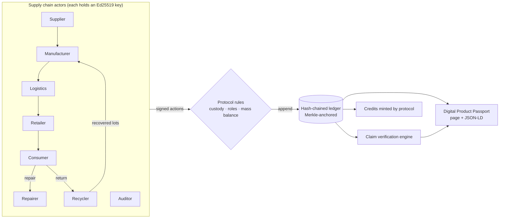

# Orbit: verifiable circular supply chains

> Every product carries its proof. Orbit gives products a **digital product passport** backed by a **signed, tamper-evident ledger**, then **checks each sustainability claim against that ledger** to catch greenwashing automatically.

Built for the **IEEE ClimateChain Global Hackathon**, track **Sustainable Supply Chains**: *increase transparency and accountability in supply chains, where ethical sourcing and sustainability claims are hard to verify.*

| Track idea | What Orbit does |
| --- | --- |
| Product lifecycle tracking | Every handover (sourcing, manufacture, shipping, sale, repair, return, recycling) is an EPCIS-style event, **signed with the actor's Ed25519 key** and **hash-chained** to the previous entry. |
| Digital product passports | A public passport page per product (QR code + GS1 Digital Link) and a machine-readable **UNTP / W3C VC-style JSON-LD export** that anyone can verify offline. |
| Recycling traceability | Recyclers turn returned products into **new recycled material lots that link back to their source product**. Recycled content is **proven by mass balance**, not declared. |
| Circular economy incentives | The protocol mints **credits** only when a matching signed event exists: deposit refund on return, a bonus for repair-instead-of-replace, and recovery credits per kg. |
| *(Accountability layer)* | A **claim verification engine** grades every product A–E. Claims contradicted by the data are flagged, and vague wording ("eco-friendly", "carbon neutral") is linted against the EU Empowering Consumers Directive. |

---

## The demo story (seeded)

| Passport | What it shows |
| --- | --- |
| 👕 **Orbit Tee** · grade **A** | Honest product. 40% recycled claim matches batch lineage; carbon claim covers the ledger-derived footprint; SA8000 labour claim approved by an independent auditor. |
| 🧥 **EcoCloud Hoodie** · grade **E** | Greenwashing. It claims "70% recycled, 100% eco-friendly", but the ledger proves **6.7%**. "Carbon neutral 1.2 kg" is contradicted by **6.0 kg** (it was air-freighted), and the auditor rejected the labour claim. |
| 🔋 **Strata E-bike Battery** | Full life: shipped → sold → **repaired** (owner earns credits) → **returned** (deposit refunded) → **recycled** into 3 new recovered lots. |
| ♻️ **Strata Loop Edition** | **Closed loop.** Built from the recovered lots of the first battery: **93% recycled content**, about 65% lower footprint, linked back to its ancestor passport. |

Then, live in the UI:
1. **Ledger → Tamper simulator**: flip the hoodie's failed audit to "APPROVE". Integrity immediately fails, the hoodie's passport shows a red tampering banner, and the trust score drops to 10.
2. **Verify**: load a passport and your browser re-checks every hash and signature with no server trust. Edit one character in the JSON and watch it fail.
3. **Console**: act as Priya (consumer) and return the Orbit Tee (+20 credits). Then act as Re:Fibre (recycler), recycle it, and see new recycled lots appear. As Lumen (brand), try publishing "90% recycled" on the hoodie and watch it get contradicted on the spot.

---

## Quick start

```bash
npm install
npm run dev        # http://localhost:3000
npm test           # 15 tests on the core engine (node:test, no extra deps)
```

Requires Node 22.6+ (tests use Node's built-in TypeScript type stripping). State lives in `data/orbit-db.json`. Delete it, or `POST /api/actions/reset`, to restore the demo world.

---

## How it works



**Ledger.** Each entry is `{index, type, subjectId, actorId, timestamp, place, data, prevHash}`. It is hashed with SHA-256 over canonical JSON (sorted keys) and signed with Ed25519 by the actor. `verifyLedger()` re-derives every hash, checks every link, and verifies every signature. A Merkle root of all entry hashes is checkpointed (`ANCHORED` entries). That root is the value you would post to a public chain; see `contracts/OrbitAnchor.sol`.

**Passports are committed at birth.** The `MANUFACTURED` entry stores `passportHash = sha256(bill of materials, GTIN, serial, …)`, and each claim's `CLAIM_ISSUED` entry stores its `claimHash`. If someone quietly edits a product record later, the passport flags it.

**Protocol rules enforced on every write** (`src/lib/actions.ts`):
- Only the current custodian can ship; only the addressed recipient can receive.
- **Mass balance**: a material lot can't be drawn into products beyond its mass.
- Only recyclers can mint recycled lots, so suppliers can't invent recycled content.
- Brands can only claim things about their own products; only independent auditors can attest.
- Credits are minted by the protocol key, never by participants.

**Claim verification** (`src/lib/verify.ts`):

| Claim | Checked against |
| --- | --- |
| Recycled content % | Mass-weighted recycled share of the input lots (lineage) |
| Carbon footprint | Materials (virgin vs recycled factors) + metered factory energy + every shipping leg (distance × mass × GLEC mode factor) |
| Origin | Location signed on the manufacture event |
| Labour standard | Requires an independent auditor's signed approval |
| Repairability | Declared score and recorded repair events |

A rejection by any auditor overrides the brand. The trust score combines verified-claim ratio and traceability depth, subtracts penalties for contradictions and banned wording, and is capped at 10 if tampering is detected.

---

## API

All writes go through one endpoint and are validated, signed and appended atomically (rolled back on error).

| Method | Path | Body |
| --- | --- | --- |
| `GET` | `/api/passport/:id` | n/a. Returns the self-verifying JSON-LD passport. |
| `GET` | `/api/ledger` | n/a. Returns the full ledger, public keys and integrity report. |
| `POST` | `/api/actions/create-batch` | `{producerId, material, massKg, recycledKg?}` |
| `POST` | `/api/actions/manufacture` | `{brandId, name, category, inputs:[{batchId, massKg}], depositCredits, co2eKg, …}` |
| `POST` | `/api/actions/ship` | `{productId, actorId, toId, mode: ship\|rail\|truck\|air}` |
| `POST` | `/api/actions/receive` | `{productId, actorId}` |
| `POST` | `/api/actions/sell` | `{productId, actorId, toId}` |
| `POST` | `/api/actions/repair` | `{productId, actorId, note}` |
| `POST` | `/api/actions/return` | `{productId, actorId, toId}` |
| `POST` | `/api/actions/recycle` | `{productId, actorId}` |
| `POST` | `/api/actions/issue-claim` | `{productId, issuerId, kind, value, statement, evidence?}` |
| `POST` | `/api/actions/attest` | `{claimId, auditorId, verdict: APPROVE\|REJECT, note}` |
| `POST` | `/api/actions/redeem` | `{actorId, rewardId}` |
| `POST` | `/api/actions/anchor` · `tamper` · `restore` · `reset` | demo controls |

```bash
curl -X POST localhost:3000/api/actions/issue-claim -H 'content-type: application/json' \
  -d '{"productId":"DPP-0002","issuerId":"lumen","kind":"RECYCLED_CONTENT","value":90,"statement":"90% recycled"}'
# -> claim is created, then shows as CONTRADICTED on /passport/DPP-0002
```

---

## Standards it borrows from

- **UN Transparency Protocol (UNTP)** Digital Product Passport and **W3C Verifiable Credentials** for the passport document shape
- **GS1 EPCIS 2.0** for the event vocabulary (what / where / when / who), and **GS1 Digital Link** for product identifiers
- **EU ESPR (2024/1781)** and the **EU Battery Regulation (2023/1542)**, which bring passports, carbon footprint and recycled content declarations
- **EU Empowering Consumers Directive (2024/825)** for the greenwashing lint rules
- **GLEC Framework** for transport emission factors

## Project layout

```
src/lib/        core engine (framework-free, fully unit tested)
  crypto.ts     canonical JSON, SHA-256, Ed25519, Merkle proofs
  ledger.ts     append + full integrity verification
  actions.ts    validated write operations (the protocol rules)
  domain.ts     custody, mass balance, carbon, credits (derived views)
  verify.ts     claim verification engine + trust score
  greenwash.ts  vague-claim linter
  passport.ts   JSON-LD passport export
  seed.ts       reproducible demo world
src/app/        Next.js pages + API routes
contracts/      optional on-chain Merkle root anchor (Solidity)
tests/          node:test suite
```

## Honest limitations / roadmap

- **Demo keys are derived server-side** so the demo is reproducible. In production each actor signs with their own wallet, HSM or DID key, and Orbit only stores public keys. The ledger format already supports this because verification only needs public keys.
- Emission factors are **illustrative** values from public LCA summaries, not certified accounting.
- Storage is a single JSON document. The next step is Postgres plus periodic anchoring of the Merkle root to a public L2 (`contracts/OrbitAnchor.sol`).
- Next: IoT and scale-weight attestations at handovers, zero-knowledge proofs so suppliers can prove mass balance without revealing volumes, and integration with EU DPP registry once live.

## Inspiration & prior art

We studied these open-source projects before designing Orbit. All code here is our own.
- [eclipse-tractusx/digital-product-pass](https://github.com/eclipse-tractusx/digital-product-pass): DPP visualisation in the Catena-X ecosystem
- [openepcis/openepcis-dpp-ready](https://github.com/openepcis/openepcis-dpp-ready): harmonised DPP vocabularies (GS1, ESPR, UNTP)
- [artiso-ai/dppvalidator](https://github.com/artiso-ai/dppvalidator): DPP compliance validation
- [faizack/Supply-Chain-Blockchain](https://github.com/faizack/Supply-Chain-Blockchain): Ethereum supply chain dApp
- [geraldinabeutnagel/ChainTrace](https://github.com/geraldinabeutnagel/ChainTrace): traceability architecture with IoT and ZK roadmap

Unlike most traceability demos that only *record* data, Orbit also *checks the claims against it*. That check is how the track's accountability problem gets addressed.

## License

MIT
