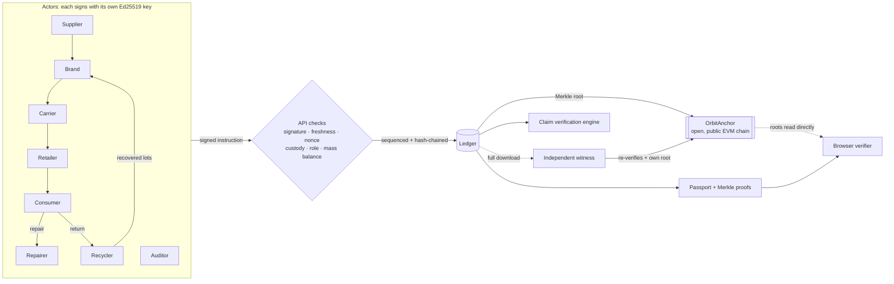

# Orbit: verifiable circular supply chains

> Green claims, checked against the supply chain. Orbit gives every product a **digital product passport** backed by **actor-signed, hash-chained records whose Merkle roots are anchored on a public blockchain by Orbit _and_ by independent witnesses**, then **checks every sustainability claim against that record** to catch greenwashing automatically.

Built for the **IEEE ClimateChain Global Hackathon**, track **Sustainable Supply Chains**: *increase transparency and accountability in supply chains, where ethical sourcing and sustainability claims are hard to verify.*

⛓️ **Live contract:** [`OrbitAnchor` v2 on Base Sepolia · 0x8a9b…9151](https://sepolia.basescan.org/address/0x8a9bd10b411a5509916dbe812fd803611c2f9151). Open to anyone. Its history already shows checkpoints from two independent parties: Orbit's operator wallet and a witness wallet.

📄 [Problem statement](docs/PROBLEM_STATEMENT.md) · 🌍 [Climate impact assessment & projections](docs/IMPACT.md) · 🔐 [Security & data integrity assessment](docs/SECURITY.md) · 📝 [Devpost write-up](docs/DEVPOST.md)

| Track idea | What Orbit does |
| --- | --- |
| Product lifecycle tracking | Every handover (sourcing, manufacture, shipping, sale, repair, return, recycling) is an EPCIS-style event. It carries an **instruction signed in the actor's own browser or wallet (Ed25519)**, is **hash-chained**, and its Merkle root is **anchored on-chain**. |
| Digital product passports | A public passport page per product (QR code + GS1 Digital Link) and a **UNTP / W3C VC-style JSON-LD export with Merkle inclusion proofs**. The browser verifies it against the blockchain directly. |
| Recycling traceability | Recyclers turn returned products into **new recycled material lots linked to their source product**. Recycled content is **proven by mass balance**, not declared. |
| Circular economy incentives | The protocol mints **non-transferable credits** only against a matching signed event: deposit refund on return, a bonus for repair-instead-of-replace, and recovery credits per kg. Supply is publicly auditable through the anchored ledger ([why not a token](#incentives-why-credits-are-not-a-tradable-token)). |
| *(Accountability layer)* | A **claim verification engine** grades every product A–E. Claims the data contradicts are flagged. **Self-reported inputs are disclosed**, and **declared facts are cross-checked against the counter-party's signature** (e.g. transport mode against the recipient's signed arrival time). Vague wording such as "eco-friendly" or "carbon neutral" is linted against EU Directive 2024/825. |

## The demo story

| Passport | What it shows |
| --- | --- |
| 👕 **Orbit Tee** · grade **A** | Honest product. Its 40% recycled claim matches batch lineage, every transport leg's declared mode fits the recipient's signed arrival time, and the labour claim is approved by an independent auditor. The carbon claim is verified but flagged because 54% of it rests on self-reported factory data. |
| 🧥 **EcoCloud Hoodie** · grade **E** | Greenwashing, caught four ways: it claims "70% recycled, 100% eco-friendly", but the ledger proves **6.7%**. Lumen **declared sea freight**, but GreenLoop's **signed receipt 24 h later** proves 2,892 km could only have gone by air. That turns "carbon neutral 1.2 kg" into **6.0 kg**, and the auditor rejected the labour claim. |
| 🔋 **Strata E-bike Battery** | Full life: shipped → sold → **repaired** (owner earns credits) → **returned** (deposit refunded) → **recycled** into 3 new recovered lots. |
| ♻️ **Strata Loop Edition** | **Closed loop.** Built from those recovered lots: **93% recycled content** and about 65% lower footprint, linked back to its ancestor passport. |

**Live demo path (3 minutes)**
1. **Overview → "See a greenwashed product get caught"**: the hoodie's contradicted claims, including the misdeclared sea freight.
2. **Ledger → Tamper simulator → "Shrink the hoodie's freight leg"**: a malicious operator rewrites and **re-signs** all later history. Every local hash and signature still checks out, but **both Orbit's and the independent witness's on-chain roots show MISMATCH**, and the passport turns red. The simulation auto-restores after 90 s.
3. **Verify**: your browser re-checks keys, signatures, signed-instruction bindings and Merkle proofs, then reads the root **straight from Orbit's published contract**, along with any witness roots.
4. **Console**: act as Priya and return the tee (+20 credits); the request is signed in your browser. As Re:Fibre, recycle it. As Lumen, claim "90% recycled" on the hoodie and watch it get contradicted.

## Quick start

```bash
npm install
npm run dev          # http://localhost:3000 (works without a chain: checkpoints stay local-only)
npm test             # 31 unit + storage tests (node:test)
```

> **Judges:** a fresh clone generates its own random keys, so it builds a *new* ledger that isn't anchored on our contract. Its passports show "local checkpoint only", and the operator-rewrite demo has nothing on-chain to be caught against. To see it anchored, follow the steps below (about 5 minutes with a faucet), or inspect our contract's public history on BaseScan.

### Anchor on a public testnet (Base Sepolia by default)

```bash
npm run wallet            # creates Orbit's anchor wallet in .env.local and prints its address
# fund that address with a little Base Sepolia ETH from a faucet
npm run deploy:anchor     # deploys OrbitAnchor, writes ORBIT_ANCHOR_ADDRESS to .env.local
npm run dev               # the ledger is anchored on boot and ~45 s after the last write
```

**Be an independent witness** (any auditor, recycler or NGO can do this):

```bash
npm run wallet -- --witness              # a separate wallet that Orbit doesn't control
npm run fund:witness                     # (demo convenience) send it 0.00002 test ETH
ORBIT_URL=http://localhost:3000 npm run witness              # verify everything, then anchor what you saw
ORBIT_URL=http://localhost:3000 npm run witness -- --watch 120   # keep watching
```

The witness downloads the full ledger, **re-verifies every hash and signature itself**, and compares it with every root anyone has already published. If history disagrees, it **refuses to anchor and raises an alert**. `npm run test:chain` runs the contract integration test against a local node (`npx hardhat node`).

## How it works



- **Identity.** Each actor publishes its public key in a self-signed `ACTOR_REGISTERED` entry. Verifiers take keys only from these entries, never from the server's records.
- **Writes.** The client signs `{action, actorId, body, nonce, issuedAt}`. The API (`src/lib/dispatch.ts`) verifies the signature and rejects stale requests, replays and impersonation. It then applies the protocol rules (`src/lib/actions.ts`). The entry embeds the signed instruction, is hash-chained, and is signed by the sequencer to fix its order.
- **Checks** (`src/lib/ledger.ts`): every hash, link and sequencer signature; every actor's signature; that each entry matches what the actor signed (`auth.ts`); no replays; and recomputed roots against every on-chain root for this ledger (`chain.ts`).
- **Counter-party cross-checks** (`src/lib/domain.ts`): the shipper declares the transport mode, but the recipient signs the arrival. An impossible speed for the declared mode (sea faster than 900 km/day, say) contradicts the declaration, and the leg is counted with the lowest-emission mode that could have made the trip.
- **Claims** (`src/lib/verify.ts`):
  - **Recycled %:** checked against mass-balanced lot lineage.
  - **Carbon:** checked against supplier-signed lots, factory data (flagged as self-reported) and cross-checked transport legs (GLEC factors).
  - **Origin:** checked against the signed manufacture site.
  - **Labour:** needs an independent auditor attestation. An auditor's rejection overrides the brand.

See **[docs/SECURITY.md](docs/SECURITY.md)** for the full threat model, including what a malicious operator can and cannot do and how the oracle problem is handled.

## Why a blockchain (and why only roots)

A signed database proves who said what. On its own it can't stop whoever runs it from rewriting history and re-signing it. The tamper simulator shows exactly that attack passing every local check. What the chain adds:

1. **Public, unrevisable timestamps.** Once a Merkle root is in a Base block, neither Orbit nor anyone else can change it.
2. **No gatekeeper.** `OrbitAnchor` v2 is **open**: anyone can anchor a root for a ledger, and the contract records who did (`submitter`). An auditor, recycler or NGO runs `npm run witness` from its own wallet. If Orbit later rewrites history, every witness's root contradicts it. If Orbit withholds events from its own anchors, a witness that saw them has already published them. Orbit's operator wallet has no special rights in the contract.
3. **Verification without trust.** A passport carries Merkle inclusion proofs, and the browser verifier reads roots straight from the contract over a public RPC. The contract address is pinned in code, so a forged passport can't redirect the check. `verifyInclusion` checks the same proofs natively in Solidity, so another contract (a token, an insurer, a customs system) can act on Orbit events without trusting Orbit.

Only 32-byte roots go on-chain. Supplier identities, volumes and prices stay off-chain, and one transaction covers any number of events.

## Scalability

Measured with `node scripts/bench.ts 10000` on a Windows dev laptop (Node 24, native Ed25519), and on-chain figures from our Base Sepolia transactions:

| Operation | Cost | Grows with |
| --- | --- | --- |
| Signed write (verify instruction, apply rules, sequence, append to log) | ≈ 1.1 ms | constant |
| Integrity check after a write (incremental verify + append-only Merkle tree) | ≈ 0.9 ms at 10,000 entries | O(new entries + log n) |
| Full independent audit from scratch (what a witness does) | ≈ 1.0 ms per entry (10 s for 10,000) | O(n), one-off, parallelisable |
| Merkle inclusion proof in a passport | 14 hashes, 448 bytes at 10,000 entries | O(log n) |
| On-chain anchor | **146,180 gas** (measured), covering any number of events | constant |
| Anchor fee on Base Sepolia | 8.8 × 10⁻⁷ ETH at 0.006 gwei (measured) | constant |
| Anchor fee on Base mainnet (estimate) | at 0.005–0.05 gwei: 7 × 10⁻⁷ – 7 × 10⁻⁶ ETH, ≈ $0.002–$0.02 at $3,000/ETH | constant |

Anchoring hourly costs roughly **$20–$200 per year per ledger, whatever the event volume**. Storage is an append-only JSON Lines log (`data/ledger.jsonl`), so a write appends one line. Rollback truncates instead of copying, and replay and key lookups use incremental caches. The production path is Postgres with an append-only ledger table, with a ledger per brand or consortium (`ledgerId` already partitions checkpoints on-chain).

## Incentives: why credits are not a tradable token

Orbit's circular credits are deliberately **non-transferable and redeemable only for rewards**:

- **They reward behaviour, not speculation.** A tradable token invites farming, wash-trading and price swings, and a deposit refund that's worth a different amount next week stops working as a deposit.
- **Regulation.** A transferable token with market value can fall within the EU's MiCA crypto-asset rules. Closed-loop rewards redeemable within a limited network are treated differently. We don't want legal classification to drive the design of a recycling incentive.
- **They're still accountable.** Only the protocol mints, and only against a signed event (each `CREDIT_MINTED` entry references the hash of the return, repair or recycling that triggered it). Every mint and redemption is in the anchored Merkle root, so the total supply and every issuance are publicly auditable.
- **There's an on-chain path if a scheme wants one.** Because `OrbitAnchor.verifyInclusion` proves events on-chain, a token contract (non-transferable ERC-5192, or ERC-20 if a regulator approves) can mint **only** against an anchored `RETURNED` or `RECYCLED` event proof. No operator can mint from nothing.

## API

| Method | Path | Body |
| --- | --- | --- |
| `GET` | `/api/passport/:id` | n/a. Returns the self-verifying JSON-LD passport with Merkle proofs and anchor reference. |
| `GET` | `/api/ledger` | n/a. Returns all entries, `ledgerId`, registered keys and an integrity report (what witnesses consume). |
| `POST` | `/api/actions/{create-batch, manufacture, ship, receive, sell, repair, return, recycle, issue-claim, attest, redeem}` | `{ request: {action, actorId, body, nonce, issuedAt}, signature }`, signed by the actor |
| `POST` | `/api/actions/anchor` | `{}`. Publishes the current root on-chain. |
| `POST` | `/api/actions/{tamper, restore, reset}`, `GET /api/demo/keys` | Demo mode only (`ORBIT_DEMO_MODE`). Tamper auto-restores after 90 s; reset is limited to once per 2 minutes. |

## Stack

Next.js 15 · React 19 · TypeScript · Tailwind CSS v4 · Ed25519 & SHA-256 via Node's native crypto on the server and audited `@noble/curves` / `@noble/hashes` in the browser (byte-identical, strict RFC 8032) · `viem` · Solidity 0.8.26 (`solc`) · `motion`, `@number-flow/react`, `lucide-react`, `sonner` for the UI.

## Standards it borrows from

UNTP Digital Product Passport & W3C Verifiable Credentials · GS1 EPCIS 2.0 & Digital Link · EU ESPR 2024/1781 · EU Battery Regulation 2023/1542 · EU Directive 2024/825 (greenwashing) · GLEC Framework (transport emissions).

## Project layout

```
src/lib/        core engine (framework-free, unit tested)
  crypto.ts     canonical JSON, pluggable Ed25519/SHA-256, Merkle tree (batch + incremental) & proofs
  crypto-node.ts  native backend for servers, scripts and tests
  auth.ts       signed instructions + entry/instruction binding checks
  dispatch.ts   API write path: signature, freshness, nonce, impersonation
  ledger.ts     append + incremental integrity verification (with anchored roots)
  actions.ts    protocol rules (custody, roles, mass balance, credits)
  domain.ts     derived views: custody, mass balance, carbon, transport cross-checks
  verify.ts     claim verification engine + trust score + self-reported caveats
  chain.ts      publish & check anchors (viem)   anchor-read.ts  browser-safe reads
  passport.ts   JSON-LD passport with Merkle proofs
  store.ts      append-only JSON Lines storage with rollback
  seed.ts       reproducible demo world, every action actor-signed
contracts/      OrbitAnchor.sol (v2, open anchoring) + compiled artifact
scripts/        compile, wallet, deploy, witness, fund, keystore, bench
tests/          core + storage tests, on-chain integration test
docs/           problem statement, impact assessment, security assessment, Devpost text
```

## Limitations

Demo mode serves the demo actors' keys to the role-play console; in production keys stay in each actor's wallet. Emission factors are illustrative. The sequencer is centralised, but its output is checked by open, multi-party anchoring. Full list in [SECURITY.md §6](docs/SECURITY.md#6-residual-risks--limitations).

## Inspiration & prior art

We studied these open-source projects before designing Orbit. All code here is our own.
[eclipse-tractusx/digital-product-pass](https://github.com/eclipse-tractusx/digital-product-pass) · [openepcis/openepcis-dpp-ready](https://github.com/openepcis/openepcis-dpp-ready) · [artiso-ai/dppvalidator](https://github.com/artiso-ai/dppvalidator) · [faizack/Supply-Chain-Blockchain](https://github.com/faizack/Supply-Chain-Blockchain) · [geraldinabeutnagel/ChainTrace](https://github.com/geraldinabeutnagel/ChainTrace)

## License

MIT
