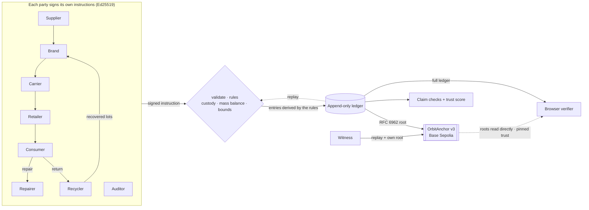

# Orbit: green claims, checked against the supply chain

[](https://github.com/ayushagarwalhere/orbit/actions/workflows/ci.yml)

**A hoodie says "70% recycled, carbon neutral, ethically made". Orbit's passport for it says: 6.7% recycled, 6.0 kg CO₂e, labour audit rejected. Grade E.**

Orbit gives every product a digital product passport. The passport doesn't repeat what the brand says. It checks each claim against what *other* parties signed: the supplier who sold the fibre, the retailer who received the parcel, the auditor who visited the factory. If those signatures contradict the label, the passport says so, and shows why.

Built for the **IEEE ClimateChain Global Hackathon**, track **Sustainable Supply Chains**.

📄 [Problem statement](docs/PROBLEM_STATEMENT.md) · 🌍 [Climate impact](docs/IMPACT.md) · 🔐 [Security](docs/SECURITY.md) · 📝 [Devpost write-up](docs/DEVPOST.md) · 🧾 [Be a witness](docs/WITNESS_GUIDE.md)

## How the hoodie gets caught

| The label says | Who contradicts it | What the passport shows |
| --- | --- | --- |
| "70% recycled" | The fibre suppliers' signed lots: only 0.05 kg of the 0.75 kg used was recycled | **6.7% recycled**: contradicted |
| Shipped by sea | The retailer signed for it **24 hours** after it left, 2,892 km away. Ships don't go that fast. | **Misdeclared: it went by air** |
| "Carbon neutral, 1.2 kg" | Recomputed with the real transport mode | **6.0 kg CO₂e**: contradicted |
| "Ethically made" | An independent auditor's signed verdict | **Audit rejected** |

The passport scores this **E (0/100)** and lists every point gained and lost, so the grade can be checked. An honest product in the same demo, the Orbit Tee, gets an A. A battery goes through its whole life (sold, repaired, returned, recycled), and its recovered materials become a new battery with **93% recycled content**, provable back to the original passport.

## Why you can believe the passport

Anyone who can edit a database can make a passport say anything. Orbit makes that visible:

1. **Every party signs its own step** with its own key. Orbit can't sign for them.
2. **Everything else is recomputed from those signatures by public rules**: distances, recycled content, credits. If Orbit changes a number, recomputing exposes it.
3. **A fingerprint of the whole history goes on a public blockchain** (Base Sepolia), from Orbit's wallet and from **witnesses' own wallets**. If Orbit deletes the failed audit and rebuilds everything after it, the fingerprints stop matching.
4. **Your browser checks all of this itself**, on the Verify page. It doesn't trust Orbit's server.

The Ledger page lets you try three attacks and see each one caught. After verifying, anyone with a browser wallet can **become a witness** in one click: the browser re-checks the whole ledger, then anchors its fingerprint from their own wallet.

## Circular incentives

Returning, repairing and recycling earn **non-transferable credits**, redeemable for repairs, transit top-ups or tree planting. In a real scheme the brand's EPR fee would fund the return reward. Credits only appear as a consequence of a signed return, repair or recovery, so Orbit can't mint them from nothing. Repairs earn credit at most once per product every 30 days. ([Why not a tradable token](#why-credits-are-not-a-tradable-token).)

## Try it (3 minutes)

```bash
npm install
npm run dev     # http://localhost:3000
npm test        # 57 tests
```

1. **Overview**: on a wide screen, drag the globe beside the headline. It shows every city where a party signs and the routes products actually took on the ledger, with the misdeclared leg in red. Then **"See a greenwashed product get caught"**: the hoodie's passport and the "Why 0/100" breakdown. Further down, **Check any claim**: paste a line from a real label and see whether EU rules ban the wording and what signed data Orbit would test it against.
2. **Ledger → tamper simulator**: three attacks, three defences.
   - An intruder edits a credit, and a hash breaks.
   - Orbit itself shortens a freight leg and re-signs. Recomputing gives 2,892 km again.
   - Orbit erases the failed audit and rebuilds all later history through the real rules. Every local check passes; only the on-chain fingerprints disagree.

   Simulations stay in memory and undo themselves after 90 s.
3. **Verify**: load the hoodie. Your browser rebuilds the ledger, checks it against the chain and re-derives every verdict. With a wallet holding a little Base Sepolia ETH, you can then anchor it yourself as a witness.
4. **Console → "Create my key & join"**: become a consumer whose key never leaves your browser, buy something and return it for the reward.

**Live contract:** [OrbitAnchor v3 on Base Sepolia](https://sepolia.basescan.org/address/0x8a9bd10b411a5509916dbe812fd803611c2f9151), with source verified on [Sourcify](https://repo.sourcify.dev/84532/0x8A9BD10b411A5509916dbe812fd803611C2F9151). Its history shows checkpoints from Orbit's operator and from a witness wallet. That witness is a second wallet run by our team, to show the role; we're inviting outside witnesses ([guide](docs/WITNESS_GUIDE.md)).

> A fresh clone makes its own keys and a new ledger, so nothing in it is anchored on our contract until you set up a wallet (below).

## Impact

If 5% of EU textiles and batteries carried Orbit-style passports by 2030, we project about **0.08 Mt CO₂e avoided per year** (plausible range 0.01–0.25), mostly from longer textile life and more fibre-to-fibre recycling. The biggest uncertainty is how many people actually repair. Every input is sourced in [IMPACT.md](docs/IMPACT.md), and the in-app Impact page reproduces the arithmetic.

---

## For developers

### Anchor on a public testnet

```bash
npm run wallet            # creates Orbit's anchor wallet in .env.local and prints its address
# fund it with a little Base Sepolia ETH from a faucet
npm run deploy:anchor     # deploys OrbitAnchor, writes ORBIT_ANCHOR_ADDRESS to .env.local
npm run dev               # anchors on boot, then at most every 10 minutes while there are new events
```

Add your deployment and operator address to `OFFICIAL_ANCHORS` in `src/lib/networks.ts`, so the browser verifier trusts them.

**Witness** (any auditor, recycler, NGO or judge, from their own wallet). Details in [WITNESS_GUIDE.md](docs/WITNESS_GUIDE.md):

```bash
npm run witness -- --file ledger.jsonl --check-only   # verify a ledger file: no wallet, no gas
npm run wallet -- --witness                           # creates your witness wallet; fund it from a faucet
npm run witness                                       # verify, then anchor from your own wallet
```

### How it works



- **The ledger is the only source of truth.** No other state is stored. Actors, lots, products, claims, audits, credits and checkpoints are rebuilt by **replaying** the signed instructions through the same rules as the live API (`replay.ts`). The same replay acts as a verifier: if anyone, Orbit included, alters a derived value or adds an entry with no instruction behind it, replay names the field that differs.
- **Writes** (`dispatch.ts`) check:
  - the signature against the registered key
  - the ledger id
  - 5-minute freshness and a single-use nonce
  - no impersonation
  - strict schemas: unknown fields are rejected, and requests are capped at 16 KB

  Then the rules run (`actions.ts`).
- **Merkle trees** follow **RFC 6962**, as in Certificate Transparency. `OrbitAnchor` can also verify inclusion and consistency proofs in Solidity.
- **The browser verifier** (`passport-verify.ts`):
  1. Reads the checkpoint from Orbit's pinned contract and checks it came from Orbit's pinned operator.
  2. Downloads the ledger and re-hashes it; the root must equal the on-chain root.
  3. Checks it against every checkpoint from Orbit and named witnesses.
  4. Re-checks every signature and replays every instruction.
  5. Checks the passport leaves no anchored event out.
  6. Re-derives every verdict and the grade.

  If no named witness has anchored the ledger yet, it shows a warning.
- **Counter-party cross-checks** (`domain.ts`):
  - the recipient's signed arrival time tests the declared transport mode
  - lot lineage tests recycled content
  - auditors' signatures test labour claims
  - self-reported inputs (factory energy) are labelled as such

The full threat model, including what is still possible, is in [SECURITY.md](docs/SECURITY.md).

### Why a blockchain, and why only fingerprints

A signed database proves who said what, but whoever runs it can rewrite history and re-sign it. The "erase" attack does exactly that, and passes every local check, replay included. The chain adds:

- **timestamps nobody can revise**
- **open anchoring**, so witnesses publish from their own wallets and Orbit's wallet has no special rights
- **roots any browser can read directly** through a public RPC

Only fingerprints go on-chain (a 32-byte root, the ledger id and its length), and one transaction covers any number of events. The demo ledger itself is public, though: the passport page offers a public view (supplier names, lots and quantities hidden) and a regulator and recycler view, and [SECURITY.md](docs/SECURITY.md) describes the commitment-based design a real deployment would need.

### Quality checks

Lighthouse 12.6 (mobile, simulated throttling) on all 7 pages of a production build: **accessibility 100, best practices 100, SEO 100** on every page; performance 82–90. These are automated checks, not user testing.

### Scalability

Measured with `node scripts/bench.ts 10000` on an idle Windows laptop (Node 24); a busy machine ran 3–5× slower. Gas figures come from our Base Sepolia transactions.

| Operation | Cost |
| --- | --- |
| Signed write (verify, validate, apply rules, append) | ≈ 0.7 ms |
| Integrity check after a write (incremental) | ≈ 1 ms at 10,000 entries |
| Full audit from scratch, replay included | ≈ 0.9 ms per entry (9 s for 10,000) |
| Passport export | ≈ 17 ms at 10,000 entries |
| On-chain anchor | ≈ 146k gas, whatever the number of events; ≈ $0.002–$0.02 on Base mainnet |

The browser verifier downloads the whole ledger. That's fine at demo scale. Production would use one ledger per brand or consortium (`ledgerId` already separates them on-chain), plus signed snapshots, so the download doesn't grow forever.

### Why credits are not a tradable token

- **They reward behaviour, not speculation.** A tradable token invites farming and wash-trading, and a reward worth a different amount next week stops working as an incentive.
- **Regulation.** A transferable token with market value can fall under the EU's MiCA rules. Closed-loop rewards are treated differently.
- **They're still accountable.** Replay rejects any credit the rules don't produce, and every mint sits inside the anchored roots.
- **There's an on-chain path if a scheme wants one.** `OrbitAnchor.verifyInclusion` would let a non-transferable token mint only against an anchored `RETURNED` or `RECYCLED` event.

### API

| Method | Path | Notes |
| --- | --- | --- |
| `GET` | `/api/passport/:id` | JSON-LD passport (UNTP DPP data model) with inclusion proofs and an anchor reference |
| `GET` | `/api/ledger[?from=N]` | Entries, `ledgerId`, registered keys and an integrity report |
| `GET` | `/api/proof?m=&n=` | RFC 6962 consistency proof (optional: the verifier computes roots itself) |
| `POST` | `/api/actions/{create-batch, manufacture, ship, receive, sell, repair, return, recycle, issue-claim, attest, redeem, register-actor}` | `{ request: {action, ledger, actorId, body, nonce, issuedAt}, signature }`, signed by the actor. Only consumers may self-register, as `guest-…`, at most 20 per 10 minutes. |
| `POST` | `/api/actions/anchor` | Publishes the current root. Rate-limited, and a no-op if nothing changed. |
| `POST` | `/api/actions/{tamper, restore, reset}`, `GET /api/demo/keys` | Demo mode only (on in dev; `ORBIT_DEMO_MODE=1` in production) |

### Stack and standards

Next.js 15 · React 19 · TypeScript · Tailwind v4 · native Ed25519/SHA-256 on the server and audited `@noble/curves` / `@noble/hashes` in the browser (byte-identical, strict RFC 8032) · `viem` · Solidity 0.8.26.

Standards: UNTP Digital Product Passport (data model) · GS1 EPCIS 2.0 & Digital Link (restricted-range demo GTINs) · RFC 6962 / 9162 · EU ESPR 2024/1781 · EU Battery Regulation 2023/1542 · EU Directive 2024/825 (greenwashing) · GLEC Framework.

### Project layout

```
src/lib/          core engine (framework-free, unit tested)
  dispatch.ts     the single write path: validation, signatures, freshness, nonce, ledger id
  actions.ts      protocol rules (custody, roles, mass balance, recovery bounds, credits)
  replay.ts       deterministic replay: rebuilds all state, verifies every derived entry
  ledger.ts       append, incremental integrity checks, the ledger's Merkle tree
  domain.ts       custody, mass balance, carbon, transport cross-checks
  verify.ts       claim checks + trust score with breakdown
  passport-verify.ts  trustless passport verification (browser + tests)
  witness-browser.ts  re-check and anchor from a visitor's own wallet
  greenwash.ts    EU 2024/825 wording rules + "check any claim"
  chain.ts / anchor-read.ts / networks.ts   anchoring, chain reads, pinned trust roots
  crypto.ts       canonical JSON, Ed25519/SHA-256, RFC 6962 Merkle tree
contracts/        OrbitAnchor.sol (v3)
scripts/          wallet, deploy, witness, fund, live verify, bench
tests/            core, storage, RFC 6962, verifier and on-chain tests
docs/             problem, impact, security, Devpost, witness guide, user-testing kit
```

### Limitations

- **Demo keys.** In demo mode the server holds the role-play actors' keys. Guest consumers keep their own; in production every key would stay with its owner.
- **Demo witness.** The only witness so far is our own second wallet.
- **Self-reported data.** Factory energy is self-reported and labelled as such. Emission factors are illustrative.
- **Physical facts.** A recycler can overstate its yield up to the input mass, and a shipper can record a shipment early. Signed scale weights and carrier pickup signatures would fix this.

Full list: [SECURITY.md](docs/SECURITY.md).

## Inspiration & prior art

We studied these open-source projects before designing Orbit. All code here is our own.
[eclipse-tractusx/digital-product-pass](https://github.com/eclipse-tractusx/digital-product-pass) · [openepcis/openepcis-dpp-ready](https://github.com/openepcis/openepcis-dpp-ready) · [artiso-ai/dppvalidator](https://github.com/artiso-ai/dppvalidator) · [faizack/Supply-Chain-Blockchain](https://github.com/faizack/Supply-Chain-Blockchain) · [geraldinabeutnagel/ChainTrace](https://github.com/geraldinabeutnagel/ChainTrace)

## License

MIT
